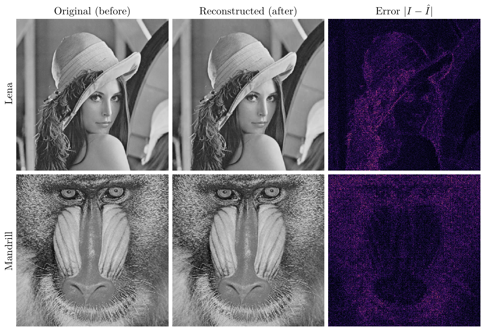
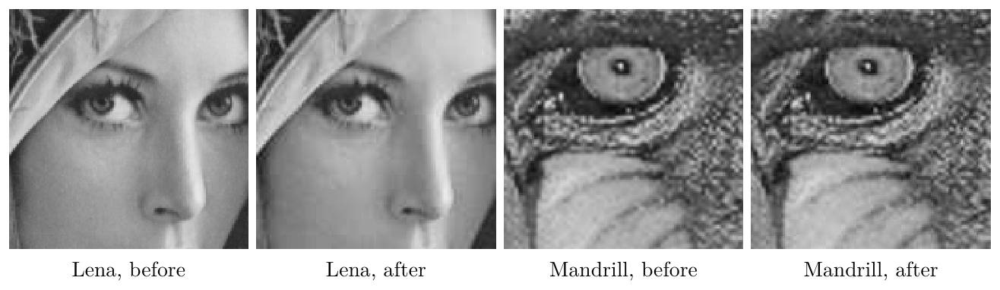
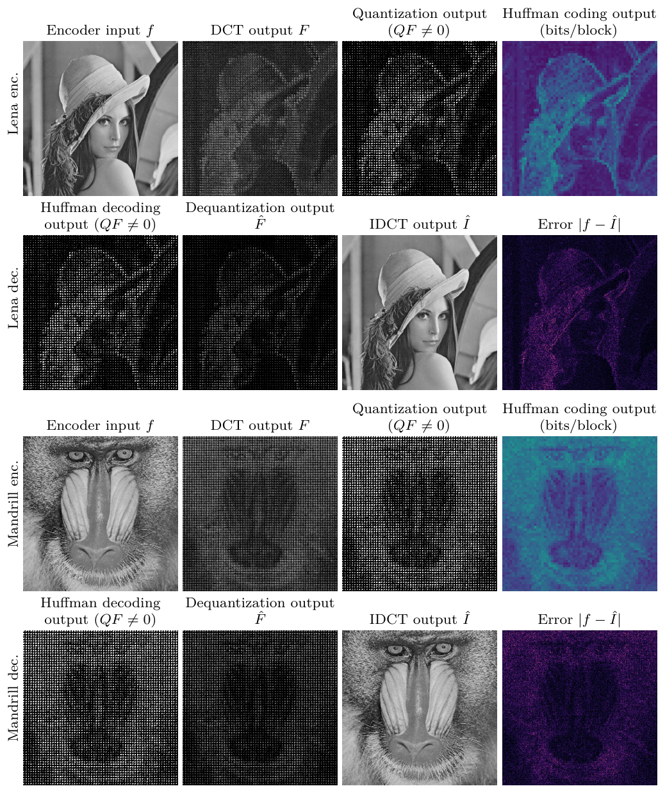
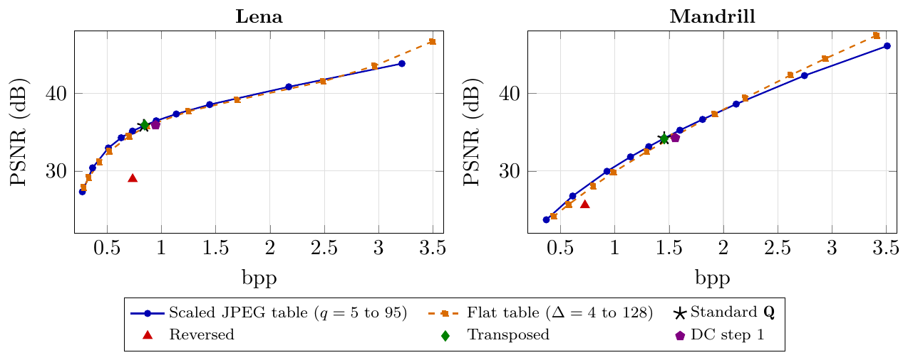
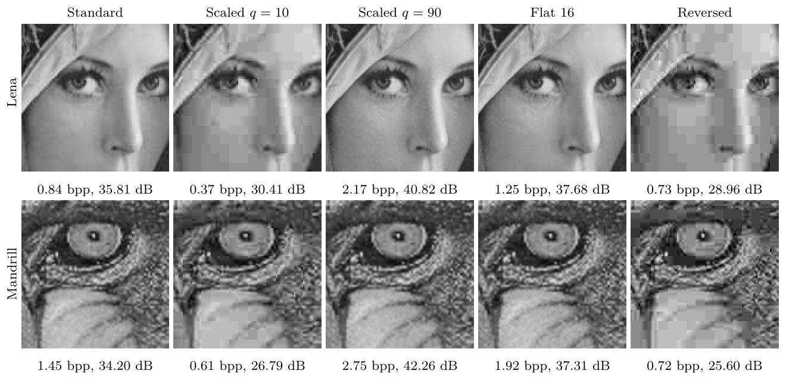
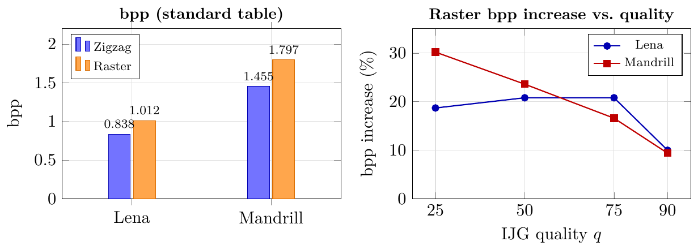
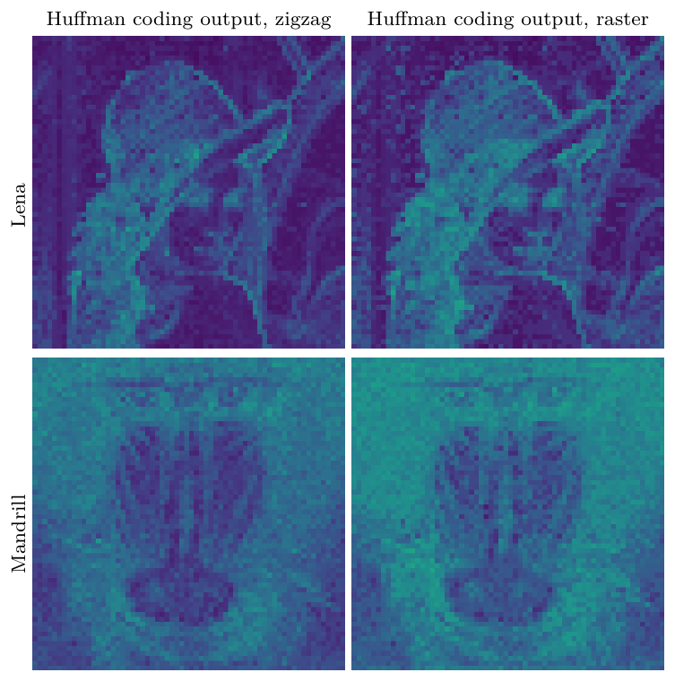
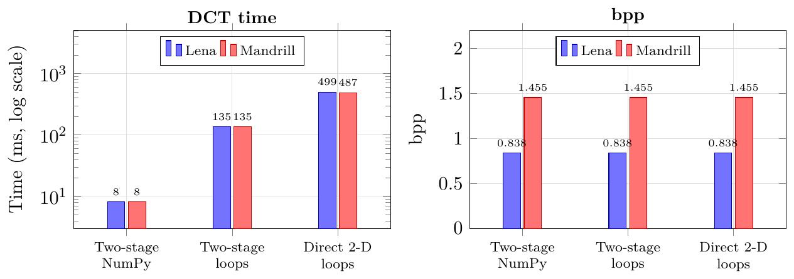
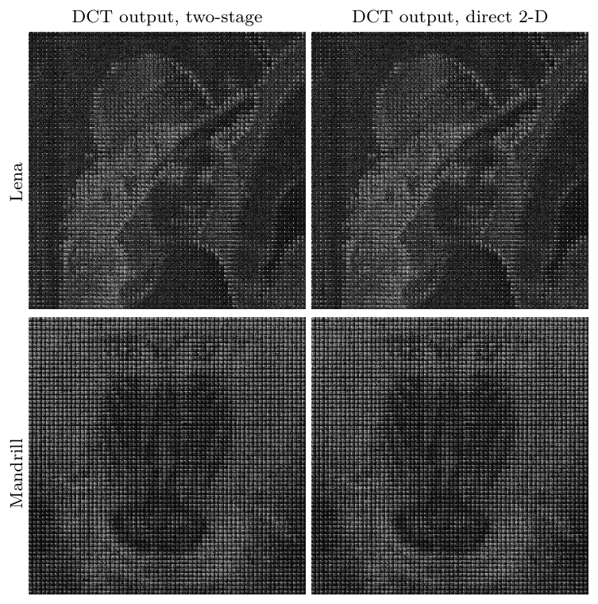

## Video Compression HW1: Spatial Coding
### ***Student:*** Pham Minh Long 龍志
### ***Student ID***: 314540080
### ***University:*** National Yang Ming Chiao Tung University (NYCU)

## Introduction

A JPEG style spatial codec for 8-bit grayscale images, built on the course template ([VC_HW1.pdf](VC_HW1.pdf)).
Each 8x8 block is transformed, quantized, zigzag scanned and Huffman coded into a bitstream, and the decoder inverts every stage to rebuild the image.

## Setup


```bash
conda create -n vc python=3.12 -y
conda activate vc
pip install numpy pillow
brew install tectonic
```

## Usage

### Encode, decode and evaluate

```bash
mkdir -p outputs
python encoder.py data/lena_gray.png outputs/output.bin --trace outputs/encoder_trace.txt --block-index 0
python decoder.py outputs/output.bin outputs/reconstructed.png --trace outputs/decoder_trace.txt --block-index 0
python evaluate.py data/lena_gray.png outputs/reconstructed.png outputs/output.bin
```


### Check both test images against the reference

```bash
for img in lena mandril; do
  python encoder.py data/${img}_gray.png outputs/${img}.bin --trace outputs/${img}_encoder_trace.txt > /dev/null
  python decoder.py outputs/${img}.bin outputs/${img}_reconstructed.png --trace outputs/${img}_decoder_trace.txt > /dev/null
  python evaluate.py data/${img}_gray.png outputs/${img}_reconstructed.png outputs/${img}.bin
done
```

### Ablation studies


```bash
python ablation/ablation.py
python ablation/extra.py
python ablation/stage_figs.py
```

### Report, figures and submission

```bash
cd report && tectonic --outdir .. HW1_314540080.tex && cd ..
python report/export_figures.py
rm -f HW1_314540080.zip
zip -j HW1_314540080.zip encoder.py decoder.py HW1_314540080.pdf
```


## Results

All numbers come from Python 3.12.9 and NumPy 2.5.3 on an Apple M2 (`outputs/` and `ablation/results.json`), on the two 512x512 test images.

### Codec against the reference

| Metric | Lena reference | Lena ours | Mandrill reference | Mandrill ours | Tolerance |
|---|---:|---:|---:|---:|---|
| Valid payload bits | 219548 | 219544 | 381276 | 381278 | 27 bits |
| File size (bytes) | 27448 | 27447 | 47664 | 47664 | not specified |
| bpp | 0.837646 | **0.837616** | 1.454590 | **1.454590** | 0.0001 |
| MSE | 17.069725 | 17.069817 | 24.699440 | 24.699432 | 0.01 |
| PSNR (dB) | 35.808538 | **35.808515** | 34.203933 | **34.203934** | 0.01 |



*Before and after coding with the standard Q table, and the absolute error.*


*Zoomed crops (3 times).*


*Input and output of each block for the standard codec.*

### Ablation 1: quantization table (bpp, PSNR)

| Table | Lena bpp | Lena PSNR (dB) | Mandrill bpp | Mandrill PSNR (dB) |
|---|---:|---:|---:|---:|
| Standard `Q` (baseline) | 0.8376 | 35.81 | 1.4546 | 34.20 |
| Scaled, `q = 10` (coarser) | 0.3656 | 30.41 | 0.6120 | 26.79 |
| Scaled, `q = 90` (finer) | 2.1726 | 40.82 | 2.7464 | 42.26 |
| Flat, step 16 | 1.2505 | 37.68 | 1.9207 | 37.31 |
| Transposed `Q` | 0.8455 | 35.92 | 1.4552 | 34.14 |
| Reversed `Q(7-u, 7-v)` | 0.7347 | 28.96 | 0.7249 | 25.60 |
| DC step 1, `Q(0,0) = 1` | 0.9457 | 35.89 | 1.5570 | 34.26 |

<details>
<summary>Full rate and distortion sweep</summary>

| Quality `q` | Lena bpp | Lena PSNR (dB) | Mandrill bpp | Mandrill PSNR (dB) |
|---:|---:|---:|---:|---:|
| 5 | 0.2715 | 27.33 | 0.3689 | 23.73 |
| 10 | 0.3656 | 30.41 | 0.6120 | 26.79 |
| 20 | 0.5111 | 32.96 | 0.9279 | 29.96 |
| 30 | 0.6292 | 34.28 | 1.1443 | 31.82 |
| 40 | 0.7330 | 35.13 | 1.3125 | 33.13 |
| 50 | 0.8376 | 35.81 | 1.4546 | 34.20 |
| 60 | 0.9512 | 36.46 | 1.5992 | 35.24 |
| 70 | 1.1363 | 37.33 | 1.8083 | 36.63 |
| 80 | 1.4438 | 38.54 | 2.1176 | 38.60 |
| 90 | 2.1726 | 40.82 | 2.7464 | 42.26 |
| 95 | 3.2145 | 43.81 | 3.5090 | 46.08 |

| Flat step | Lena bpp | Lena PSNR (dB) | Mandrill bpp | Mandrill PSNR (dB) |
|---:|---:|---:|---:|---:|
| 4 | 3.4969 | 46.66 | 3.4106 | 47.42 |
| 6 | 2.9603 | 43.50 | 2.9380 | 44.44 |
| 8 | 2.4884 | 41.51 | 2.6196 | 42.33 |
| 12 | 1.6977 | 39.13 | 2.1991 | 39.38 |
| 16 | 1.2505 | 37.68 | 1.9207 | 37.31 |
| 24 | 0.8665 | 35.79 | 1.5428 | 34.43 |
| 32 | 0.7018 | 34.46 | 1.2940 | 32.48 |
| 48 | 0.5218 | 32.55 | 0.9891 | 29.86 |
| 64 | 0.4301 | 31.16 | 0.8025 | 28.06 |
| 96 | 0.3310 | 29.16 | 0.5750 | 25.70 |
| 128 | 0.2848 | 27.88 | 0.4381 | 24.18 |

</details>


*PSNR and bpp of the quantization table variants.*


*Decoded crops (IDCT output) with different Q tables.*

### Ablation 2: zigzag against raster scan (bpp, PSNR)


| Image | Scan | bpp | bpp increase | PSNR (dB) | `VALUE(0)` per block |
|---|---|---:|---:|---:|---:|
| Lena | Zigzag | 0.8376 | baseline | 35.809 | 4.58 |
| Lena | Raster | 1.0121 | +20.8% | 35.809 | 10.17 |
| Mandrill | Zigzag | 1.4546 | baseline | 34.204 | 7.63 |
| Mandrill | Raster | 1.7971 | +23.6% | 34.204 | 18.59 |

| Quality `q` | Lena | Mandrill |
|---:|---:|---:|
| 25 | +18.7% | +30.2% |
| 50 | +20.8% | +23.6% |
| 75 | +20.8% | +16.6% |
| 90 | +10.0% | +9.4% |


*The bpp of zigzag and raster (left) and the bpp increase of raster at different quality (right).*


*Bits per block after Huffman coding (blue means few bits, yellow means many bits).*

### Ablation 3: two-stage 1-D DCT against direct 2-D DCT (time, bpp)

The direct version computes the double sum `F(u,v) = sum_x sum_y C(u,x) f(x,y) C(v,y)` with four nested loops. Time covers only the DCT of one full image (median of repeated runs).

| Implementation | Multiplications per block | Lena time (ms) | Mandrill time (ms) | Lena bpp | Mandrill bpp |
|---|---:|---:|---:|---:|---:|
| Two-stage, NumPy (submitted) | 1024 | 8.11 | 8.10 | 0.837616 | 1.454590 |
| Two-stage, Python loops | 1024 | 134.93 | 134.98 | 0.837616 | 1.454590 |
| Direct 2-D, Python loops | 4096 | 498.78 | 486.83 | 0.837616 | 1.454559 |


*DCT time (log scale) and bpp.*


*DCT output of the two methods, shown as log(1 + |F|).*

## Citation

```bibtex
@misc{videocompression2026hw1,
  title  = {Video Compression 2026 HW1: Spatial Coding},
  author = {NYCU Video Compression 2026 Fall TAs},
  year   = {2026}
}

@article{ahmed1974dct,
  title   = {Discrete Cosine Transform},
  author  = {Ahmed, N. and Natarajan, T. and Rao, K.R.},
  journal = {IEEE Transactions on Computers},
  volume  = {C-23},
  number  = {1},
  pages   = {90--93},
  year    = {1974}
}

@article{wallace1991jpeg,
  title   = {The JPEG still picture compression standard},
  author  = {Wallace, Gregory K.},
  journal = {Communications of the ACM},
  volume  = {34},
  number  = {4},
  pages   = {30--44},
  year    = {1991}
}
```
