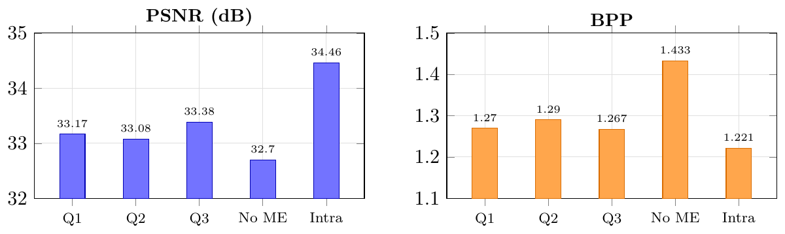
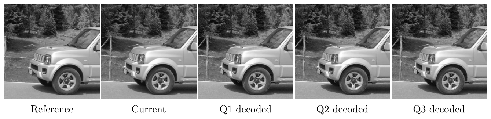
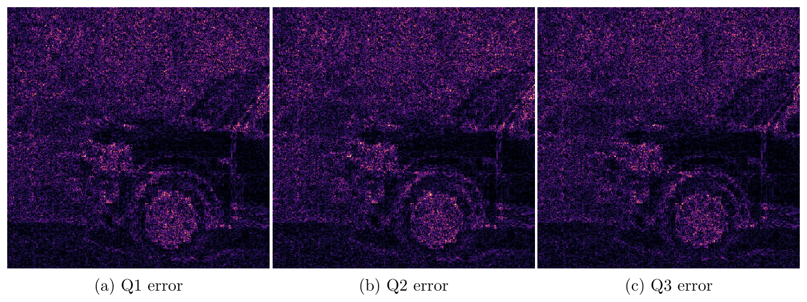
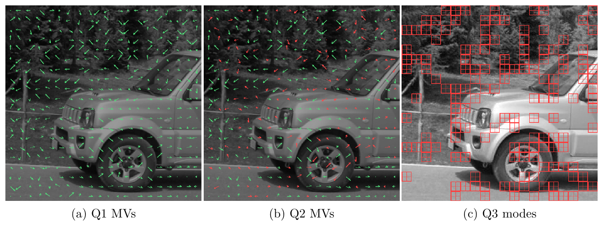
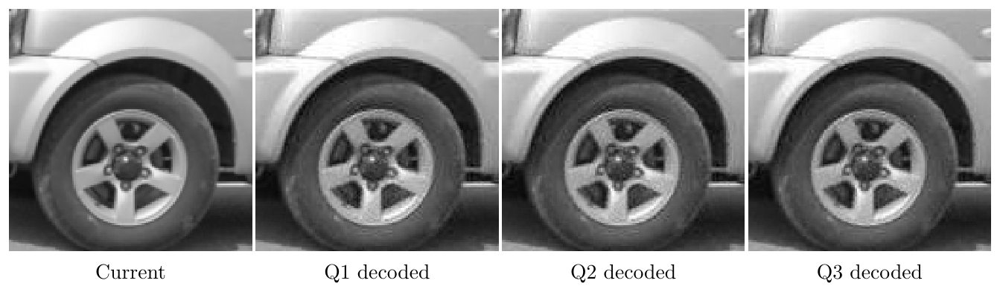

## Video Compression HW2: Motion Estimation
### ***Student:*** Pham Minh Long 龍志
### ***Student ID***: 314540080
### ***University:*** National Yang Ming Chiao Tung University (NYCU)

## Introduction

An inter-frame codec that codes `two_gray.png` from `one_gray.png` with 16x16 block motion estimation, signed Exp-Golomb MVDs and the HW1 8x8 residual codec ([VC_HW2.pdf](VC_HW2.pdf)).
Q1 uses Full Search, Q2 uses three-step search (TSS), and Q3 adds block-size RDO that picks one 16x16 MV or four 8x8 MVs per macroblock with `J = SSD + 64R`.


## Setup

```bash
conda create -n vc python=3.12 -y
conda activate vc
pip install numpy pillow
brew install tectonic poppler
```
## Usage

### Encode, decode and check the bitstream syntax

```bash
export PYTHONDONTWRITEBYTECODE=1
for m in full_search three_step_search three_step_rdo; do
  python src/encoder.py --reference images/one_gray.png --current images/two_gray.png --method $m --output outputs/$m/encoded.bin
  python src/decoder.py --reference images/one_gray.png --input outputs/$m/encoded.bin --method $m --output outputs/$m/decoded.png
  python provided/evaluator.py images/one_gray.png images/two_gray.png outputs/$m/encoded.bin outputs/$m/decoded.png --method $m
done
```

| Step | Output |
|---|---|
| Encoder | `outputs/{method}/encoded.bin` |
| Decoder | `outputs/{method}/decoded.png` |
| Evaluator | Syntax check, mode counts, BPP and PSNR printed to the terminal |

### Verification and experiments

```bash
python ablation/verify.py
python ablation/experiments.py
python ablation/figures.py
```

### Report, figure and submission

```bash
cd report && tectonic --outdir .. HW2_314540080.tex && cd ..
python report/export_figures.py
rm -rf outputs/HW2_314540080 HW2_314540080.zip
python run_local.py --student-id 314540080 --method all --output-root outputs
cp HW2_314540080.pdf outputs/HW2_314540080/report/
python provided/check_submission.py outputs/HW2_314540080
(cd outputs && zip -r -X ../HW2_314540080.zip HW2_314540080 -x "*/__pycache__/*" "*.DS_Store")
```
## Results


| Method | PSNR (dB) | BPP | MVD bits | Residual bits | Search points per MB | Encode time (s) | 16x16 / 8x8 MBs |
|---|---:|---:|---:|---:|---:|---:|---:|
| Q1 Full Search | 33.165 | 1.2697 | 3796 | 125786 | 204.5 | 0.38 | 400 / 0 |
| Q2 TSS | 33.080 | 1.2901 | 3986 | 127685 | 23.6 | 0.17 | 400 / 0 |
| Q3 TSS + RDO | **33.384** | **1.2672** | 8090 | 121233 | 121.3 | 0.45 | 257 / 143 |
| No ME (all MV = 0) | 32.696 | 1.4330 | 800 | 145499 | | | 400 / 0 |
| Intra (HW1 codec) | 34.463 | 1.2214 | | | | | |



*PSNR and BPP of the three methods and the two baselines.*


*Input frames and the decoded frames of Q1, Q2 and Q3.*


*Absolute error of the decoded frames, from black (0) to yellow (32 or more).*


*Q1 and Q2 motion vectors (red arrows differ from Q1) and the Q3 mode map (red grid means four 8x8 blocks).*


*Zoomed crops (3 times) around the front wheel.*

### Search range study (Full Search, 16x16)

| Search range | Mean MAD | MVs on the search border | Most common `dx` |
|---|---:|---:|---|
| ±7 | 15.60 | 244 of 400 | 7 (147), -7 (67) |
| ±15 | 11.83 | 92 of 400 | -15 (51), 9 (40), 10 (26) |
| ±32 | 6.66 | 11 of 400 | -28 (123), -29 (36), 9 (32) |

## Citation

```bibtex
@misc{videocompression2026hw2,
  title  = {Video Compression 2026 HW2: Motion Estimation},
  author = {NYCU Video Compression 2026 Fall TAs},
  year   = {2026},
  url    = {https://hackmd.io/@G2sNDYsCS7y7FXp11rLqBQ/BkvnqHJhMl}
}

@inproceedings{zhan2007mode,
  title     = {An Efficient Mode Decision Algorithm Based on Dynamic Grouping and Adaptive Adjustment for H.264/AVC},
  author    = {Zhan, Bin and Hou, Baochun and Sotudeh, Reza},
  booktitle = {2007 IEEE International Symposium on Signal Processing and Information Technology},
  pages     = {785--790},
  year      = {2007}
}

@misc{po2009bitrate,
  title  = {Bit rate estimation in data or video compression},
  author = {Po, Lai-Man and Sarwer, Mohammed Golam},
  year   = {2009},
  note   = {US Patent Application US20090219991A1},
  url    = {https://patents.google.com/patent/US20090219991A1/en}
}
```
