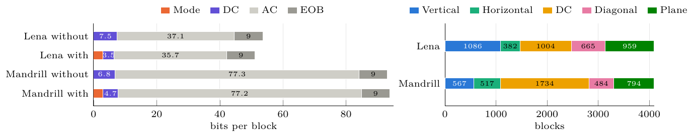
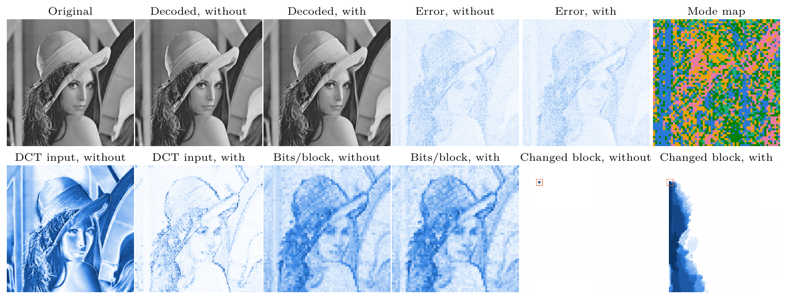

## Video Compression HW3: Intra Prediction
### ***Student:*** Pham Minh Long 龍志
### ***Student ID***: 314540080
### ***University:*** National Yang Ming Chiao Tung University (NYCU)

## Introduction

An 8x8 intra codec for 512x512 grayscale images, built on the course template ([HW3_Intra_Prediction.pdf](HW3_Intra_Prediction.pdf)).
Each block is predicted from reconstructed neighbors with five modes, and the residual goes through the HW1 DCT, quantization, zigzag and VALUE/EOB coding.

## Setup

```bash
conda create -n vc python=3.12 -y
conda activate vc
pip install numpy pillow
brew install tectonic poppler
```

## Usage

### Encode, decode and check the expected output

```bash
mkdir -p outputs
python encoder_HW3_314540080.py lena.png outputs/output.bin
python decoder_HW3_314540080.py outputs/output.bin outputs/reconstructed.png
python evaluate.py outputs/output.bin --blocks 1103,3086,414,2082,936,2325,1007,2584,246,3242 --decoder decoder_HW3_314540080.py > outputs/self_check.txt
diff --strip-trailing-cr outputs/self_check.txt expected_output.txt
```

### Trace one block

```bash
python encoder_HW3_314540080.py lena.png outputs/output.bin --trace outputs/encoder_trace.txt --block-index 246
python decoder_HW3_314540080.py outputs/output.bin outputs/reconstructed.png --trace outputs/decoder_trace.txt --block-index 246
```

### Verification and experiments

```bash
python ablation/verify.py
python ablation/experiments.py
python ablation/figures.py
```

### Report, figures and submission

```bash
cd report && tectonic --outdir .. report_HW3_314540080.tex && cd ..
python report/export_figures.py
rm -f HW3_314540080.zip
zip -j HW3_314540080.zip encoder_HW3_314540080.py decoder_HW3_314540080.py report_HW3_314540080.pdf
```

## Results

### With and without intra prediction

| Image | Prediction | bpp | PSNR (dB) | File (bytes) | Mean abs DCT input | Same, block mean removed | Encode (s) | Decode (s) |
|---|---|---:|---:|---:|---:|---:|---:|---:|
| Lena | Without | 0.8376 | 35.81 | 27446 | 39.53 | 9.54 | 0.23 | 0.04 |
| Lena | With | 0.7999 | 35.73 | 26211 | 7.34 | 6.78 | 0.47 | 0.09 |
| Mandrill | Without | 1.4546 | 34.20 | 47664 | 32.70 | 16.02 | 0.29 | 0.04 |
| Mandrill | With | 1.4664 | 34.11 | 48052 | 15.64 | 14.55 | 0.55 | 0.09 |


*Bits per block by syntax element (left) and blocks per mode, in the same colors as the mode map (right).*


*Lena results. Blue panels go from white (0) to dark blue (error 32, DCT input 96, bits 200, changed pixels 10), and the orange square marks the changed block.*

### Bits per block

| Image | Prediction | Mode | DC | AC | EOB |
|---|---|---:|---:|---:|---:|
| Lena | Without | 0.00 | 7.47 | 37.13 | 9.00 |
| Lena | With | 3.00 | 3.53 | 35.66 | 9.00 |
| Mandrill | Without | 0.00 | 6.81 | 77.27 | 9.00 |
| Mandrill | With | 3.00 | 4.67 | 77.17 | 9.00 |

### Blocks per mode

| Image | Vertical | Horizontal | DC | Diagonal Down-Left | Plane |
|---|---:|---:|---:|---:|---:|
| Lena | 1086 | 382 | 1004 | 665 | 959 |
| Mandrill | 567 | 517 | 1734 | 484 | 794 |

### One changed block

The DC of the block at `y = 64, x = 64` is raised by 5 quantization steps before decoding.

| Image | Prediction | Blocks changed | PSNR after (dB) |
|---|---|---:|---:|
| Lena | Without | 1 | 35.80 |
| Lena | With | 693 | 34.02 |
| Mandrill | Without | 1 | 34.20 |
| Mandrill | With | 1002 | 34.03 |

## Citation

```bibtex
@misc{videocompression2026hw3,
  title  = {Video Compression 2026 HW3: Intra Prediction},
  author = {NYCU Video Compression 2026 Fall TAs},
  year   = {2026}
}

@article{wiegand2003h264,
  title   = {Overview of the H.264/AVC video coding standard},
  author  = {Wiegand, T. and Sullivan, G.J. and Bjontegaard, G. and Luthra, A.},
  journal = {IEEE Transactions on Circuits and Systems for Video Technology},
  volume  = {13},
  number  = {7},
  pages   = {560--576},
  year    = {2003}
}

@article{wallace1991jpeg,
  title   = {The JPEG still picture compression standard},
  author  = {Wallace, Gregory K.},
  journal = {Communications of the ACM},
  volume  = {34},
  number  = {4},
  pages   = {30--44},
  year    = {1991}
}
```
